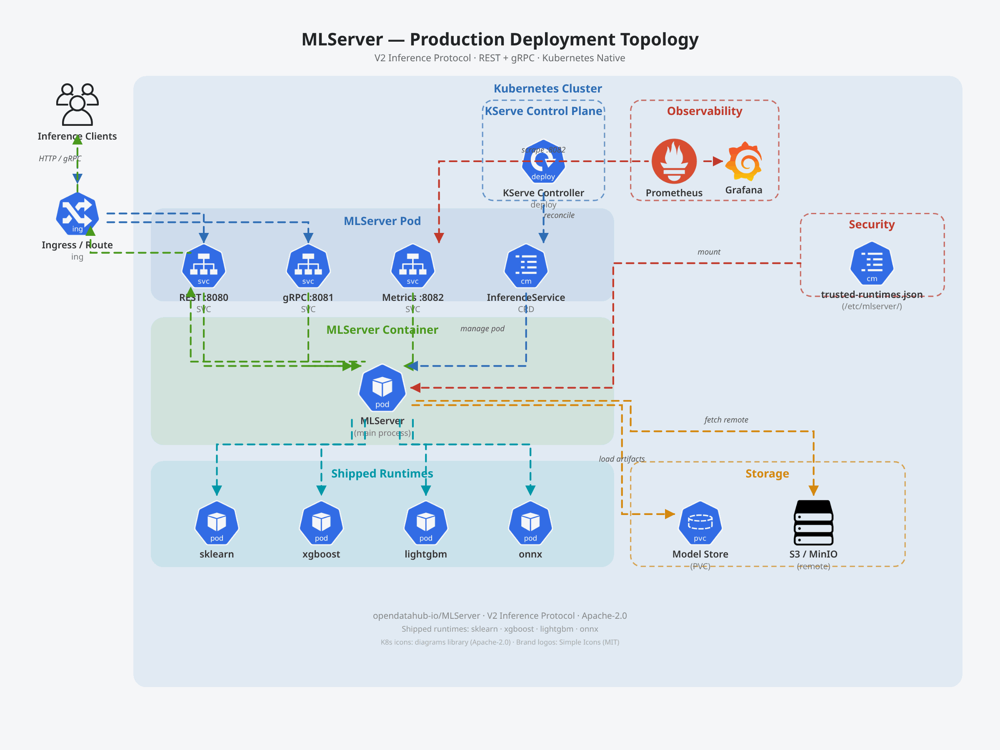

# Deployment Guide

This document covers how to deploy MLServer in different environments, from local development to production Kubernetes clusters.



---

## Container Images

MLServer ships as a set of OCI container images built via Konflux CI pipelines.

### Image Variants

| Variant | Base | GPU Support | Use Case |
|---------|------|-------------|----------|
| `mlserver` | UBI 9 (Python 3.11) | No | CPU-only inference |
| `mlserver-cuda` | UBI 9 + CUDA toolkit | NVIDIA | GPU-accelerated inference |

Images are published to the Red Hat Quay registry. The CPU image includes four
shipped runtimes (sklearn, xgboost, lightgbm, onnx) while the CUDA image
includes only onnx.

### Runtime Security Modes

Production images include a `/etc/mlserver/trusted-runtimes.json` allowlist that restricts which model implementations can be loaded:

| Mode | Trigger | Behavior |
|------|---------|----------|
| **DEVELOPMENT** | No allowlist file present | All `implementation` values accepted |
| **PRODUCTION** | Allowlist file exists | Only allowlisted import paths accepted |

See [security.md](security.md) for the full security model.

---

## Local Development

### Running from Source

```bash
# Install dependencies
poetry install --with dev

# Start with default settings
mlserver start .

# Start with custom settings
mlserver start /path/to/model/repository
```

### Running with Docker

```bash
# Build local image
docker build -t mlserver:dev .

# Run with model repository mounted
docker run -p 8080:8080 -p 8081:8081 -p 8082:8082 \
  -v /path/to/models:/mnt/models \
  -e MLSERVER_MODEL_REPOSITORY_ROOT=/mnt/models \
  mlserver:dev
```

---

## Kubernetes Deployment

### Standalone Pod

```yaml
apiVersion: v1
kind: Pod
metadata:
  name: mlserver
  labels:
    app: mlserver
spec:
  containers:
    - name: mlserver
      image: quay.io/opendatahub/mlserver:latest
      ports:
        - containerPort: 8080
          name: http
        - containerPort: 8081
          name: grpc
        - containerPort: 8082
          name: metrics
      env:
        - name: MLSERVER_MODEL_REPOSITORY_ROOT
          value: /mnt/models
        - name: MLSERVER_PARALLEL_WORKERS
          value: "2"
      volumeMounts:
        - name: model-store
          mountPath: /mnt/models
      readinessProbe:
        httpGet:
          path: /v2/health/ready
          port: 8080
        initialDelaySeconds: 10
        periodSeconds: 5
      livenessProbe:
        httpGet:
          path: /v2/health/live
          port: 8080
        initialDelaySeconds: 5
        periodSeconds: 10
      resources:
        requests:
          cpu: "500m"
          memory: "512Mi"
        limits:
          cpu: "2"
          memory: "2Gi"
  volumes:
    - name: model-store
      persistentVolumeClaim:
        claimName: model-store-pvc
```

### Service and Ingress

```yaml
apiVersion: v1
kind: Service
metadata:
  name: mlserver
spec:
  selector:
    app: mlserver
  ports:
    - name: http
      port: 8080
      targetPort: 8080
    - name: grpc
      port: 8081
      targetPort: 8081
    - name: metrics
      port: 8082
      targetPort: 8082
```

### KServe InferenceService

MLServer serves as a runtime within KServe's `ServingRuntime` framework:

```yaml
apiVersion: serving.kserve.io/v1beta1
kind: InferenceService
metadata:
  name: iris-model
spec:
  predictor:
    model:
      modelFormat:
        name: sklearn
      runtime: mlserver
      storageUri: s3://models/iris
      resources:
        requests:
          cpu: "500m"
          memory: "512Mi"
```

---

## Health Checks

MLServer exposes V2-compliant health endpoints through the default configuration for orchestrator integration:

| Endpoint | Protocol | Purpose | Kubernetes Probe |
|----------|----------|---------|------------------|
| `GET /v2/health/live` | REST | Server process is alive | `livenessProbe` |
| `GET /v2/health/ready` | REST | Server ready (see [Readiness Behavior](#readiness-behavior)) | `readinessProbe` |
| `ServerLive` | gRPC | Server process is alive | gRPC health check |
| `ServerReady` | gRPC | Server ready (see [Readiness Behavior](#readiness-behavior)) | gRPC health check |

### Readiness Behavior

The readiness check answers one question: should traffic be routed to this server? MLServer keeps serving requests whatever the answer is. It is the orchestrator, for example a Kubernetes Service, that acts on it. Two settings control the result:

| State | Readiness |
|-------|-----------|
| Startup has not completed | not ready |
| No models in the registry, `empty_registry_readiness: true` (default) | ready |
| No models in the registry, `empty_registry_readiness: false` | not ready |
| Models in the registry, `strict_readiness: true` (default) | ready only if ALL models are ready |
| Models in the registry, `strict_readiness: false` | always ready |

Both settings can be set with the `MLSERVER_STRICT_READINESS` and `MLSERVER_EMPTY_REGISTRY_READINESS` environment variables, or in `settings.json`.

#### Strict mode (default)

`strict_readiness: true` follows the V2 inference protocol, where server ready means all models are ready. The server is ready when every model in the registry is ready. A new model or model version is in the registry with `ready` false only while it is being loaded, and one that fails to load is removed from the registry. So the server is not ready while a new model or model version is loading, including when it is loaded through the model repository API after startup. Reloading a version that is already loaded does not affect readiness: the existing model stays in the registry, ready, until the new one has loaded.

#### Lenient mode

`strict_readiness: false` ignores model state, so the server stays ready while a new model or model version is loading. Loading models dynamically therefore does not block traffic to the models that are already loaded, or further requests to load and unload models. This deliberately departs from the protocol and suits deployments that load models dynamically after startup. In either mode, check individual models with `GET /v2/models/{name}/ready`. In lenient mode it is the only readiness signal for models.

#### Empty registry

The V2 protocol states the server ready API "indicates if all the models are ready for inferencing". It does not say whether that holds when no models are loaded. Either answer is useful in practice. A server may legitimately have no models, for example because models are loaded into it later, and it has to be ready to receive those requests. A deployment that expects its models to be present may instead want an empty server reported as not ready. MLServer therefore extends the protocol with the `empty_registry_readiness` setting, which defaults to ready.

The registry is empty when `load_models_at_startup` is `false`, when the model repository contains no models MLServer can read, or after all models have been unloaded.

- **`empty_registry_readiness: true`** (default) — Ready. Models can be loaded into the server through the model repository API.
- **`empty_registry_readiness: false`** — Not ready. Use this to require that models are present, for example when they are expected to be loaded at startup. While the registry is empty, an orchestrator stops routing traffic to the server, so models cannot be loaded into it through that route. Keep the default if you load models dynamically into an empty server.

`empty_registry_readiness` applies in both strict and lenient modes after startup completes.

If `empty_registry_readiness` is `false` and no models were loaded once startup completes, MLServer logs a warning, whether because `load_models_at_startup` is `false` or because none were found. It does not log again if all models are unloaded later.

#### Startup

In both modes the server is not ready until startup completes, so traffic is not routed before the initial models have loaded. If a model fails to load at startup, the server shuts down.

---

## Parallel Inference

For CPU-bound models, enable parallel workers to bypass the Python GIL:

```json
{
  "parallel_workers": 4,
  "parallel_workers_timeout": 10
}
```

Each worker runs in a separate process with its own copy of the model.
Communication between the main process and workers uses multiprocessing queues.

### Resource Considerations

- Each worker loads a full copy of the model into memory
- Total memory ≈ `parallel_workers × model_size + overhead`
- Set CPU requests/limits to at least `parallel_workers` cores
- The `.metrics` directory must be shared across workers (configured via `metrics_dir`)

---

## Metrics and Monitoring

### Prometheus Integration

MLServer exports Prometheus metrics on the metrics port (default: 8082):

```yaml
# Prometheus scrape config
- job_name: mlserver
  scrape_interval: 15s
  metrics_path: /metrics
  static_configs:
    - targets: ['mlserver:8082']
```

### Key Metrics

| Metric | Type | Description |
|--------|------|-------------|
| `model_infer_request_success` | Counter | Successful inferences per model |
| `model_infer_request_failure` | Counter | Failed inferences per model |
| `model_infer_request_duration` | Summary | Inference latency per model |
| `rest_server_requests_total` | Counter | Total REST requests |

### OpenTelemetry Tracing

Enable distributed tracing by setting the tracing server:

```json
{
  "tracing_server": "jaeger-collector:4317"
}
```

MLServer instruments FastAPI with OpenTelemetry, excluding health-check endpoints from traces.

---

## Environment Variables Reference

All `settings.json` fields can be set via environment variables:

```bash
# Server configuration
MLSERVER_HOST=0.0.0.0
MLSERVER_HTTP_PORT=8080
MLSERVER_GRPC_PORT=8081
MLSERVER_METRICS_PORT=8082
MLSERVER_DEBUG=false
MLSERVER_LOG_LEVEL=INFO
MLSERVER_ACCESS_LOG=true

# Model repository
MLSERVER_MODEL_REPOSITORY_ROOT=/mnt/models
MLSERVER_LOAD_MODELS_AT_STARTUP=true

# Parallel inference
MLSERVER_PARALLEL_WORKERS=1
MLSERVER_PARALLEL_WORKERS_TIMEOUT=5

# Tracing
MLSERVER_TRACING_SERVER=jaeger:4317
```

Model-specific settings use the `MLSERVER_MODEL_` prefix or a `.env` file alongside `model-settings.json`.

---

## CI/CD Pipelines

MLServer uses Konflux for container image builds and Prow for pre-merge testing:

| Pipeline | Trigger | Purpose |
|----------|---------|---------|
| Konflux build | Push to `release/*` | Build and publish container images |
| Prow pre-submit | PR opened | Run unit and integration tests |
| Early-gate | PR opened | Fast validation of critical paths |
| Tag creation | Manual / workflow | Create release tags |

See the `.tekton/` directory for pipeline definitions and `.github/workflows/` for GitHub Actions workflows.
